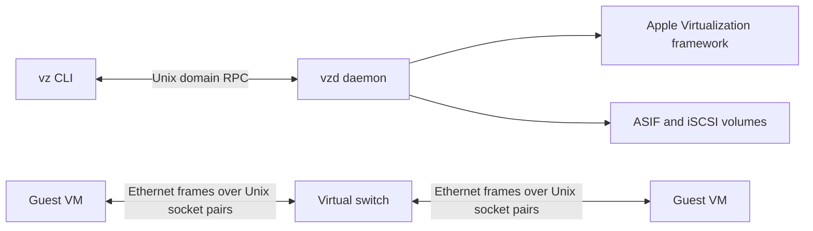

# vz

**A small macOS virtual machine manager with an isolated VM-to-VM Ethernet switch.**

`vz` is an early-stage Go project built on Apple’s Virtualization framework. It brings VM lifecycle management, virtual networking, and disk management together in a local CLI and daemon. Its switch connects VMs directly over Ethernet frames carried through Unix domain socket pairs, keeping guest-to-guest traffic separate from the host network.

> This project is under active development. Some advertised configuration options and lifecycle operations are incomplete; see [Project status](#project-status).

## What it can do

| Area | Available now |
| --- | --- |
| Virtual machines | Create, start, stop, inspect, and list VMs |
| Display | Optional VNC display and input |
| Networking | Virtualization.framework NAT, plus an isolated Ethernet switch for VM-to-VM traffic |
| Storage | Per-VM ASIF root disks and additional ASIF volumes |
| Remote storage | iSCSI LUNs exposed to guests through a local NBD attachment |

The switch currently connects guests to one another; it does not provide DHCP or an uplink to the host network. Configure guest networking manually for now.

## How it fits together



The CLI starts `vzd` when it cannot connect to the daemon socket. The daemon manages VM instances and their network and storage attachments.

## Requirements

- macOS with Apple’s Virtualization framework
- Go **1.26.4** or later
- Xcode Command Line Tools (for cgo and Apple framework bindings)

The daemon is signed locally with the `com.apple.security.virtualization` entitlement during the build. The project currently targets macOS and is not portable to Linux.

## Build

Clone the repository, then build the CLI and daemon from the repository root:

```sh
git clone https://github.com/rtgnx/vz.git
cd vz
make
```

This produces `bin/vz` and `bin/vzd`. Run the CLI from the repository root so its automatic daemon launch can find `./bin/vzd`:

```sh
./bin/vz --help
```

The daemon stores its socket and data under `~/.vm/` so existing installations
keep their VM definitions and disks after the executable rename. The daemon
socket is `~/.vm/vzd.sock`.

## Quick start

Create a switch, create a VM attached to it, then start the VM:

```sh
./bin/vz network create --type switch lab
./bin/vz create --cpus 2 --memory 4 --disk 20 --network lab devbox
./bin/vz start devbox
```

The root disk is created when the VM starts. To check the VM state or list VMs:

```sh
./bin/vz state devbox
./bin/vz list
```

To stop the VM:

```sh
./bin/vz stop devbox
```

To use Apple’s built-in NAT instead of the isolated switch, create a NAT network and attach it to a VM:

```sh
./bin/vz network create --type nat internet
./bin/vz create --network internet natbox
```

## Storage

### ASIF volumes

Create an ASIF volume and attach it to a VM as an additional disk:

```sh
./bin/vz volume create --format asif --size 20 data
./bin/vz create --volume data storage-vm
```

Sizes are specified in GiB. A VM also receives its own root disk, whose size is set with `--disk` at VM creation.

### iSCSI volumes

Register an existing iSCSI LUN as a VM volume:

```sh
./bin/vz volume create \
  --format iscsi \
  --address 192.0.2.10:3260 \
  --target iqn.2026-01.example:storage \
  --lun 0 \
  iscsi-root

./bin/vz create --volume iscsi-root iscsi-vm
```

For CHAP authentication, add `--chap-user USER --chap-secret SECRET`. Add `--read-only` to attach the LUN read-only. The target and LUN must already exist and be reachable from the Mac running `vzd`; this command registers connection details and does not create storage on the iSCSI server.

## Project status

Implemented areas are usable but still evolving. Current gaps include:

- DHCP service for switch networks
- ASIF snapshots
- Raw disk volumes
- Complete network deletion and cleanup behavior
- Broader lifecycle hardening and operational polish

The command interface is discoverable with `./bin/vz --help`; each command also has a `--help` page.

## Development

Build both binaries with `make`. To run the repository’s Go test suite:

```sh
make tests
```

Contributions, bug reports, and feedback are welcome. When reporting an issue, include the macOS version, hardware architecture, command used, and relevant `vzd` logs.
